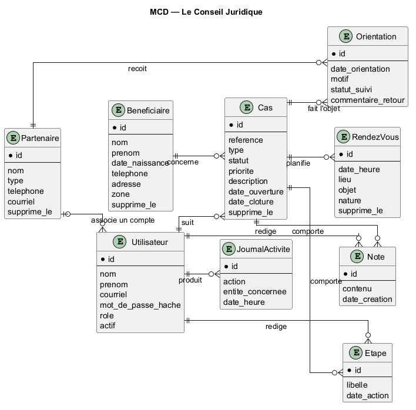
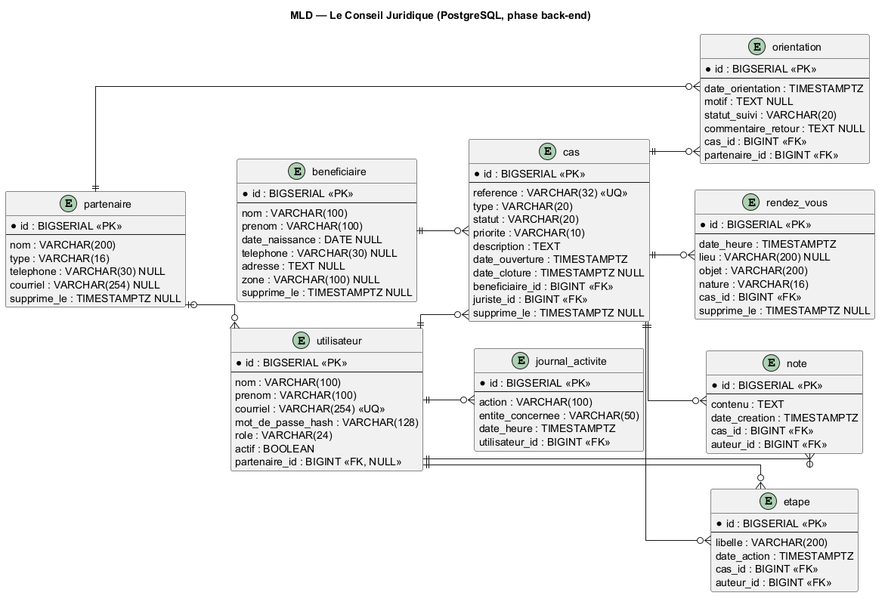

# MCD et MLD — Le Conseil Juridique

> Modèle conceptuel et logique proposé pour la V1. La base PostgreSQL sera mise en place en phase back-end; ce document ne crée ni ne configure une base de données.

## MCD — Entités et associations

Le MCD décrit les données métier sans dépendre d'un SGBD. Les identifiants sont techniques. Les valeurs de rôle, type, statut et priorité sont bornées par le périmètre V1.

### Entités

| Entité | Identifiant et attributs métier |
|---|---|
| **Utilisateur** | id, nom, prénom, courriel, mot de passe haché, rôle, actif |
| **Bénéficiaire** | id, nom, prénom, date de naissance, téléphone, adresse, zone |
| **Cas** | id, référence, type, statut, priorité, description, dates d'ouverture et de clôture |
| **Étape** | id, libellé, date de l'action |
| **Note** | id, contenu, date de création |
| **RendezVous** | id, date/heure, lieu, objet, nature (rendez-vous ou audience) |
| **Partenaire** | id, nom, type (avocat ou association), téléphone, courriel |
| **Orientation** | id, date d'orientation, motif, statut de suivi, commentaire de retour |
| **JournalActivite** | id, action, entité concernée, date/heure |

### Associations et cardinalités

| Association | Cardinalités | Interprétation |
|---|---|---|
| Bénéficiaire — Cas | Bénéficiaire `0..N`; Cas `1` | Un bénéficiaire peut ne pas encore avoir de cas ou en avoir plusieurs; chaque cas concerne un seul bénéficiaire. |
| Utilisateur — Cas (suivi) | Utilisateur `0..N`; Cas `1` | Un juriste suit zéro ou plusieurs cas; chaque cas a un juriste responsable. |
| Cas — Étape | Cas `0..N`; Étape `1` | Une étape appartient à un seul cas. |
| Utilisateur — Étape (auteur) | Utilisateur `0..N`; Étape `1` | Chaque étape est attribuée à son auteur. |
| Cas — Note | Cas `0..N`; Note `1` | Une note concerne un seul cas. |
| Utilisateur — Note (auteur) | Utilisateur `0..N`; Note `1` | Chaque note a un auteur. |
| Cas — RendezVous | Cas `0..N`; RendezVous `1` | Chaque rendez-vous ou audience est lié à un seul cas. |
| Cas — Orientation | Cas `0..N`; Orientation `1` | Chaque orientation concerne un seul cas. |
| Partenaire — Orientation | Partenaire `0..N`; Orientation `1` | Chaque orientation vise un seul partenaire. |
| Partenaire — Utilisateur (compte partenaire) | Partenaire `0..N`; Utilisateur `0..1` | Un compte d'avocat est lié, au plus, à un partenaire; un partenaire peut avoir plusieurs comptes. Cette association permet de limiter la vue avocat aux cas référés à son partenaire. |
| Utilisateur — JournalActivite (auteur) | Utilisateur `0..N`; JournalActivite `1` | Chaque entrée conserve l'auteur de l'action. |

**Valeurs contrôlées proposées :**

- `Utilisateur.role` : Administrateur, Juriste/conseiller, Agent d'accueil, Avocat partenaire, Direction/bailleur.
- `Cas.type` : Droits, État civil, Foncier, Violences, Autre.
- `Cas.statut` : Nouveau, En cours, Orienté, En attente, Résolu, Clôturé.
- `Cas.priorite` : Normale, Urgente.
- `Partenaire.type` : Avocat, Association.
- `Orientation.statut_suivi` : **À CONFIRMER** avec l'ONG; les termes de retour du cahier ne sont pas fixés dans le périmètre.

## MLD — Modèle relationnel

Les types ci-dessous sont une proposition PostgreSQL pour la phase back-end. Les domaines de rôle/type/statut peuvent être réalisés par des choix contrôlés côté application et des contraintes `CHECK`. Les noms SQL sont sans accents.

| Table | Colonnes (type; `PK`, `FK`, `UQ` indiqués) |
|---|---|
| `utilisateur` | `id BIGSERIAL PK`; `nom VARCHAR(100) NOT NULL`; `prenom VARCHAR(100) NOT NULL`; `courriel VARCHAR(254) NOT NULL UQ`; `mot_de_passe_hash VARCHAR(128) NOT NULL`; `role VARCHAR(24) NOT NULL`; `actif BOOLEAN NOT NULL DEFAULT TRUE`; `partenaire_id BIGINT NULL FK → partenaire.id` |
| `beneficiaire` | `id BIGSERIAL PK`; `nom VARCHAR(100) NOT NULL`; `prenom VARCHAR(100) NOT NULL`; `date_naissance DATE NULL`; `telephone VARCHAR(30) NULL`; `adresse TEXT NULL`; `zone VARCHAR(100) NULL`; `supprime_le TIMESTAMPTZ NULL` |
| `cas` | `id BIGSERIAL PK`; `reference VARCHAR(32) NOT NULL UQ`; `type VARCHAR(20) NOT NULL`; `statut VARCHAR(20) NOT NULL`; `priorite VARCHAR(10) NOT NULL`; `description TEXT NOT NULL`; `date_ouverture TIMESTAMPTZ NOT NULL`; `date_cloture TIMESTAMPTZ NULL`; `beneficiaire_id BIGINT NOT NULL FK → beneficiaire.id`; `juriste_id BIGINT NOT NULL FK → utilisateur.id`; `supprime_le TIMESTAMPTZ NULL` |
| `etape` | `id BIGSERIAL PK`; `libelle VARCHAR(200) NOT NULL`; `date_action TIMESTAMPTZ NOT NULL`; `cas_id BIGINT NOT NULL FK → cas.id`; `auteur_id BIGINT NOT NULL FK → utilisateur.id` |
| `note` | `id BIGSERIAL PK`; `contenu TEXT NOT NULL`; `date_creation TIMESTAMPTZ NOT NULL`; `cas_id BIGINT NOT NULL FK → cas.id`; `auteur_id BIGINT NOT NULL FK → utilisateur.id` |
| `rendez_vous` | `id BIGSERIAL PK`; `date_heure TIMESTAMPTZ NOT NULL`; `lieu VARCHAR(200) NULL`; `objet VARCHAR(200) NOT NULL`; `nature VARCHAR(16) NOT NULL`; `cas_id BIGINT NOT NULL FK → cas.id`; `supprime_le TIMESTAMPTZ NULL` |
| `partenaire` | `id BIGSERIAL PK`; `nom VARCHAR(200) NOT NULL`; `type VARCHAR(16) NOT NULL`; `telephone VARCHAR(30) NULL`; `courriel VARCHAR(254) NULL`; `supprime_le TIMESTAMPTZ NULL` |
| `orientation` | `id BIGSERIAL PK`; `date_orientation TIMESTAMPTZ NOT NULL`; `motif TEXT NULL`; `statut_suivi VARCHAR(20) NOT NULL`; `commentaire_retour TEXT NULL`; `cas_id BIGINT NOT NULL FK → cas.id`; `partenaire_id BIGINT NOT NULL FK → partenaire.id` |
| `journal_activite` | `id BIGSERIAL PK`; `action VARCHAR(100) NOT NULL`; `entite_concernee VARCHAR(50) NOT NULL`; `date_heure TIMESTAMPTZ NOT NULL`; `utilisateur_id BIGINT NOT NULL FK → utilisateur.id` |

### Règles d'intégrité et corbeille

- `utilisateur.partenaire_id` est facultatif et n'est renseigné que pour un compte partenaire; plusieurs comptes peuvent être rattachés au même partenaire.
- Les quatre entités concernées par les corbeilles ont `supprime_le`: `NULL` signifie actif, une date signifie placé dans la corbeille. La restauration remet la valeur à `NULL`; la suppression définitive retire l'enregistrement après confirmation.
- Les étapes, notes, rendez-vous et orientations sont rattachés à leurs parents par une clé étrangère obligatoire. Le journal conserve l'auteur, l'action, l'entité concernée et la date/heure, sans clé générique vers plusieurs tables.
- Un rendez-vous est lié au cas; le bénéficiaire est retrouvé via `cas.beneficiaire_id`, sans dupliquer sa clé dans `rendez_vous`.
- Les règles précises d'inscription/attribution de rôle, d'accès à un dossier et la conservation des données restent **À CONFIRMER** avant le back-end.

## Sources et exports

- MCD : [mcd.puml](plantuml/mcd.puml), [mcd.mmd](plantuml/mcd.mmd), [mcd.png](exports/mcd.png).
- MLD : [mld.puml](plantuml/mld.puml), [mld.mmd](plantuml/mld.mmd), [mld.png](exports/mld.png).

## Écarts avec le diagramme de classes existant

Le diagramme existant [class.puml](plantuml/class.puml) contient les mêmes entités métier essentielles, mais le MCD/MLD proposé le complète ou s'en écarte sur les points suivants :

1. La classe `Document` est exclue, car le module de gestion de documents est hors périmètre V1.
2. Des champs `supprime_le` sont ajoutés aux bénéficiaires, cas, rendez-vous et partenaires pour les corbeilles demandées.
3. Le lien du compte avocat vers son partenaire est explicité afin de limiter les cas consultables à ceux référés à ce partenaire.
4. Les auteurs de `Etape` et `Note` sont reliés explicitement à `Utilisateur`, et le cas possède un juriste responsable.
5. Le rendez-vous demeure lié au cas; le lien direct `Beneficiaire—RendezVous` du diagramme de classes est déduit du cas pour éviter une relation redondante.
6. La cardinalité d'un bénéficiaire vers ses cas est `0..N` plutôt que `1..N`, afin qu'une fiche puisse exister avant l'ouverture d'un cas.
7. Les noms des types, statuts et priorités suivent exactement les valeurs fournies pour la V1. Les statuts d'orientation restent à valider.

Les diagrammes UML existants ne sont pas modifiés dans cette étape; ces différences sont signalées pour validation. Le diagramme de cas d'utilisation et les séquences sur les documents ou l'export montrent aussi des fonctionnalités exclues de la V1; ils restent à réaligner lors d'une validation ultérieure des diagrammes.
